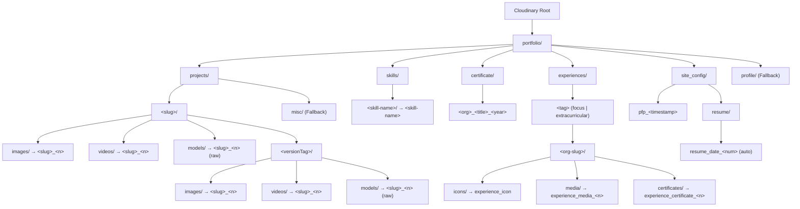

# Cloudinary Media Storage Architecture

This document defines the storage organization, directory hierarchy, naming conventions, and processing pipelines for all media assets managed by `about-core` and stored in [Cloudinary](https://cloudinary.com).

---

## 1. Cloudinary Directory Tree Diagram

Below is the complete tree representation of how folders, subdirectories, and asset public IDs are structured in Cloudinary under the root namespace `portfolio/`:

```
portfolio/
├── projects/
│   ├── <slug>/                                 # URL-safe project slug (e.g., 'portfolio-core', 'magi-system')
│   │   ├── images/
│   │   │   └── <slug>_<n>                      # Primary banner / screenshots (resource_type: image)
│   │   ├── videos/
│   │   │   └── <slug>_<n>                      # Demo video recordings (resource_type: video)
│   │   ├── models/
│   │   │   └── <slug>_<n>                      # 3D interactive assets (.glb / .gltf) (resource_type: raw)
│   │   └── <sanitizedVersionTag>/              # Nested release version directory (e.g., 'v1-0-0', 'v2-1-beta')
│   │       ├── images/
│   │       │   └── <slug>_<n>                  # Version release banner/preview (resource_type: image)
│   │       ├── videos/
│   │       │   └── <slug>_<n>                  # Version release video demo (resource_type: video)
│   │       └── models/
│   │           └── <slug>_<n>                  # Version release 3D model (resource_type: raw)
│   │
│   └── misc/                                   # Fallback directory when project slug and title cannot be derived
│       ├── images/
│       │   └── misc_<n>                        # Miscellaneous images (resource_type: image)
│       ├── videos/
│       │   └── misc_<n>                        # Miscellaneous videos (resource_type: video)
│       └── models/
│           └── misc_<n>                        # Miscellaneous raw 3D files (resource_type: raw)
│
├── profile/                                    # Fallback directory when endpoint is /profile or /profile/config
│   ├── images/
│   │   └── profile_<n>                         # Profile images (resource_type: image)
│   ├── videos/
│   │   └── profile_<n>                         # Profile videos (resource_type: video)
│   └── models/
│       └── profile_<n>                         # Profile 3D models (resource_type: raw)
│
├── skills/
│   └── <skill-name>/                           # Hyphenated, URL-safe skill name (e.g., 'typescript', 'react-native')
│       └── <skill-name>                        # Skill brand/tech icon (resource_type: image)
│
├── certificate/                                # Flat certificate storage (note singular directory name)
│   └── <org>_<title>_<year>                    # Formatted ID (e.g., 'google_cloud_certified_2025') (resource_type: image)
│
├── experiences/
│   └── <tag>/                                  # Experience categorization ('focus' | 'extracurricular')
│       └── <org-slug>/                         # Sanitized organization slug (e.g., 'google-dsc', 'ieee-student-branch')
│           ├── icons/
│           │   └── experience_icon             # Organization logo / badge (resource_type: image)
│           ├── media/
│           │   └── experience_media_<n>        # Work evidence / event photos (resource_type: image)
│           └── certificates/
│               └── experience_certificate_<n>  # Experience-specific certificates/awards (resource_type: image)
│
└── site_config/                                # Global portfolio avatar & site configuration assets
    ├── pfp_<timestamp>                         # Profile picture upload (e.g., 'pfp_1729603928123') (resource_type: image)
    └── resume/                                 # Resume PDF file storage
        └── resume_date_{num}                   # Incremental resume PDF upload without extension (e.g., 'resume_date_1') (resource_type: auto)
```

---

## 2. Mermaid Structural Visualization



---

## 3. Directory & Public ID Mapping Table

| Resource Domain | Multipart Form Field | Destination Cloudinary Folder | Public ID Strategy | Resource Type | Sample Cloudinary Public ID |
| :--- | :--- | :--- | :--- | :--- | :--- |
| **Project Banner** | `image` (max 1) | `portfolio/projects/<slug>/images` | `<slug>_<n>` | `image` | `portfolio/projects/shibraj-portfolio/images/shibraj-portfolio_1` |
| **Project Video Demo** | `videoDemo` (max 1) | `portfolio/projects/<slug>/videos` | `<slug>_<n>` | `video` | `portfolio/projects/shibraj-portfolio/videos/shibraj-portfolio_1` |
| **Project 3D Model** | `threeDModel` (max 1) | `portfolio/projects/<slug>/models` | `<slug>_<n>` | `raw` | `portfolio/projects/shibraj-portfolio/models/shibraj-portfolio_1` |
| **Project Version Image** | `image` (max 1) | `portfolio/projects/<slug>/<versionTag>/images` | `<slug>_<n>` | `image` | `portfolio/projects/shibraj-portfolio/v1-0-0/images/shibraj-portfolio_1` |
| **Project Version Video** | `videoDemo` (max 1) | `portfolio/projects/<slug>/<versionTag>/videos` | `<slug>_<n>` | `video` | `portfolio/projects/shibraj-portfolio/v1-0-0/videos/shibraj-portfolio_1` |
| **Project Version 3D Model** | `threeDModel` (max 1) | `portfolio/projects/<slug>/<versionTag>/models` | `<slug>_<n>` | `raw` | `portfolio/projects/shibraj-portfolio/v1-0-0/models/shibraj-portfolio_1` |
| **Skill Icon** | `logoUrl` (max 1) | `portfolio/skills/<derived-skill-name>` | `<derived-skill-name>` | `image` | `portfolio/skills/typescript/typescript` |
| **Certificate Media** | `mediaUrl` (max 1) | `portfolio/certificate` | `<org>_<title>_<year>` | `image` | `portfolio/certificate/google_cloud_architect_2025` |
| **Experience Icon** | `iconUrl` (max 1) | `portfolio/experiences/<tag>/<orgSlug>/icons` | `experience_icon` | `image` | `portfolio/experiences/focus/google-dsc/icons/experience_icon` |
| **Experience Media Gallery** | `mediaUrls` (max 10) | `portfolio/experiences/<tag>/<orgSlug>/media` | `experience_media_<n>` | `image` | `portfolio/experiences/focus/google-dsc/media/experience_media_1` |
| **Experience Certificates** | `certificateUrls` (max 10) | `portfolio/experiences/<tag>/<orgSlug>/certificates` | `experience_certificate_<n>` | `image` | `portfolio/experiences/focus/google-dsc/certificates/experience_certificate_1` |
| **Site Config Avatar (PFP)** | `pfp` / `pfpUrl` / `image` (max 1) | `portfolio/site_config` | `pfp_<timestamp>` | `image` | `portfolio/site_config/pfp_1729603928123` |
| **Site Config Resume PDF** | `resume` / `resumeFile` / `resumePdf` / `pdf` (max 1) | `portfolio/site_config/resume` | `resume_date_{num}` | `auto` (public access) | `portfolio/site_config/resume/resume_date_1` |
| **Misc Fallback** | `image` / `videoDemo` / `threeDModel` | `portfolio/projects/misc/<type>` | `misc_<n>` | `image` / `video` / `raw` | `portfolio/projects/misc/images/misc_1` |
| **Profile Route Fallback** | `image` / `videoDemo` / `threeDModel` | `portfolio/profile/<type>` | `profile_<n>` | `image` / `video` / `raw` | `portfolio/profile/images/profile_1` |

---

## 4. Sequential Naming & Cloudinary Search API

To prevent accidental asset overwrites without generating long random UUIDs, `about-core` implements **sequential numeric suffix naming** (`<base>_1`, `<base>_2`, `<base>_3`, ...).

### Algorithm for General Media (`getNextPublicId`)

1. **Request-Level Cache (`FolderCache`)**:
   - Each HTTP request creates an isolated in-memory `Map<string, string[] | null>`.
   - When a file in `folder` is processed, `cache.has(folder)` checks if existing public IDs were already retrieved during this request.
2. **Cloudinary Search API Execution**:
   - If not cached, the Search API executes:
     ```ts
     cloudinary.search.expression(`folder:${folder}`).max_results(500).execute()
     ```
   - The public IDs returned are mapped and cached.
3. **Suffix Extraction & Increment**:
   - Finds existing IDs starting with `${folder}/${base}_`.
   - Parses the numeric suffixes (e.g. `_1`, `_2`), computes `Math.max(...numbers) + 1`, and formats `${base}_${next}`.
   - The newly generated public ID is immediately added to the in-memory cache so subsequent files within the *same* request automatically increment to `next + 1` without issuing redundant Search API calls.
4. **Resilient Fallback**:
   - If the Cloudinary Search API rate-limits, errors, or fails, the folder entry is marked as `null` in the cache.
   - The function gracefully falls back to timestamp-based naming:
     ```ts
     return `${base}_${Date.now()}`;
     ```

### Algorithm for Resume PDF (`getNextResumePublicId`)

1. **Target Folder**: `portfolio/site_config/resume`.
2. **Search Expression**: `folder:portfolio/site_config/resume`.
3. **Suffix & Number Parsing**:
   - Scans existing IDs in `portfolio/site_config/resume` matching `resume_date_{num}` or `resume_date_{num}.pdf`.
   - Pre-existing extensions (`.pdf`, `.pdf.pdf`) are stripped prior to parsing.
   - Parses `{num}` via `parseInt(match[1], 10)` and determines `next = Math.max(...numbers) + 1`.
   - Formats public ID without file extension as:
     ```ts
     return `resume_date_${next}`;
     ```
4. **Error & Fallback Handling**:
   - If Cloudinary Search is unreachable, falls back to clean timestamp naming without extension:
     ```ts
     return `resume_date_${Date.now()}`;
     ```
5. **Access Mode & Database Persistence**:
   - Cloudinary upload explicitly specifies `access_mode: 'public'` so PDFs are viewable by public client-side viewers without `401 ACL` denial.
   - The resulting Cloudinary `secure_url` is sanitized (`.pdf.pdf` collapsed to `.pdf`) and saved directly to `resumeUrl` on the `SiteConfig` document in MongoDB.

---

## 5. Media Upload Pipeline & Constraints

### 5.1 Architecture & In-Memory Streaming
- **Zero Local Disk Footprint**: In compliance with serverless deployment guidelines (Vercel), Multer uses `multer.memoryStorage()`. No temporary files are written to the filesystem.
- **Readable Stream Piping**: File buffers are converted into Node.js `Readable` streams and piped directly into `cloudinary.uploader.upload_stream`.

### 5.2 File Limits & MIME Validation
- **Maximum File Size**: `100 MB` per file (`100 * 1024 * 1024` bytes) to accommodate high-definition demo videos and complex 3D GLB models.
- **Supported File Types**:
  - **Images**: `image/jpeg`, `image/jpg`, `image/png`, `image/webp`, `image/gif`, `image/svg+xml`. Uploaded with `resource_type: "image"`.
  - **Videos**: `video/mp4`, `video/webm`, `video/quicktime`, `video/x-matroska`. Uploaded with `resource_type: "video"`.
  - **3D Models**: Files matching `\.(glb|gltf)$/i` or MIME types `model/gltf-binary`, `model/gltf+json`, `application/octet-stream`. Uploaded with `resource_type: "raw"`.
  - **PDF Documents (Resumes)**: Files matching `application/pdf` or extension `\.pdf$/i`. Uploaded with `resource_type: "auto"`.

### 5.3 Special Sanitization Rules
- **Project Slugs**: Derived from `req.body.slug` or `req.body.title`, converted to lowercase, stripped of non-alphanumeric characters, and formatted with single hyphens (`shibraj-portfolio`).
- **Version Tags**: Trimmed, lowercased, and sanitized (`v1.0.0` &rarr; `v1-0-0`) to form safe folder names.
- **Skill Names**: Normalized to lowercase alphanumeric hyphens (`c++` &rarr; `c`, `node.js` &rarr; `node-js`).
- **Certificate Public IDs**: Formatted as `${orgSlug}_${titleSlug}_${year}` where year is extracted via regex `(19\d\d|20\d\d)` from title or date, defaulting to current year.
- **Experience Organizations**: Case-insensitively matched in MongoDB; the slug is used to namespace experience icon, media, and certificate subdirectories.
- **Profile Picture History**: Avatar uploads to `portfolio/site_config/` generate a unique `pfp_<timestamp>` public ID, returning both `pfpUrl` and `pfpPublicId`. New uploads are prepended to `pfpHistory` in MongoDB, enabling full avatar rollback and reuse.
- **Resume Uploads**: PDF files uploaded on `resume`, `resumeFile`, `resumePdf`, or `pdf` are processed under `portfolio/site_config/resume/` using `resume_date_{num}` (or `resume_date_{timestamp}` fallback) with `access_mode: 'public'`. Extensions are excluded from `public_id`, and incoming URLs/values are sanitized to avoid double-extension issues (e.g. `.pdf.pdf`), and saved to `resumeUrl` on `SiteConfig`.

---

## 6. Environment Configuration

The Cloudinary SDK is initialized in `src/config/cloudinary.ts` with forced HTTPS:

```typescript
import { v2 as cloudinary } from "cloudinary";

cloudinary.config({
  cloud_name: process.env.CLOUDINARY_CLOUD_NAME,
  api_key: process.env.CLOUDINARY_API_KEY,
  api_secret: process.env.CLOUDINARY_API_SECRET,
  secure: true,
});

export default cloudinary;
```

Required environment variables in `.env`:
```env
CLOUDINARY_CLOUD_NAME=your_cloud_name
CLOUDINARY_API_KEY=your_api_key
CLOUDINARY_API_SECRET=your_api_secret
```
